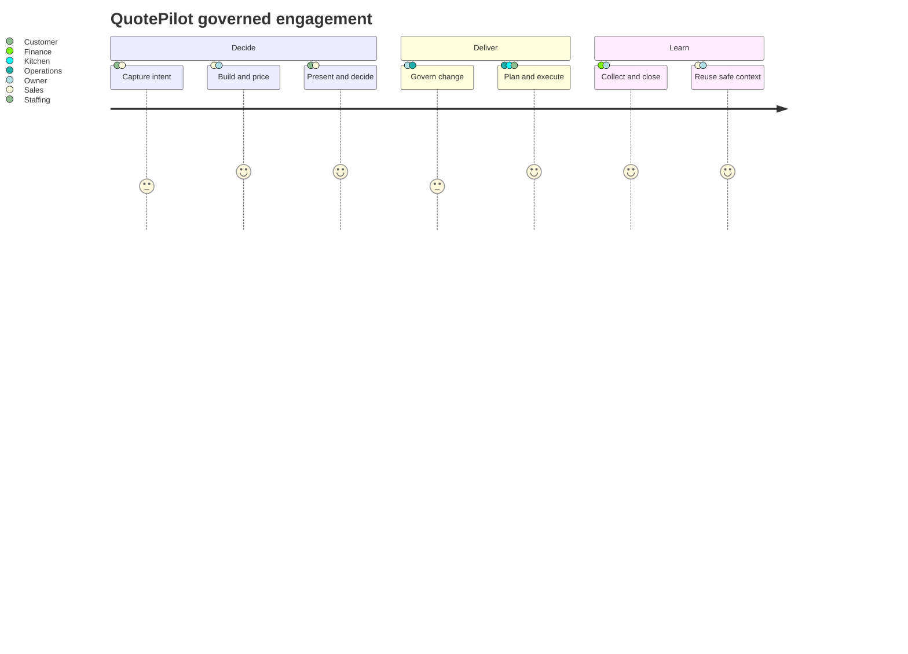
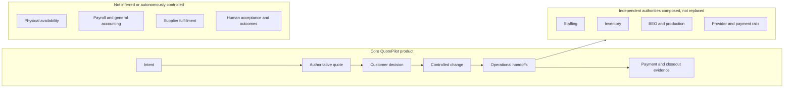

# QuotePilot Product Requirements

Last updated: 2026-09-24 01:57:41 CDT

Status: canonical system-level PRD. Feature PRDs may add detail but must trace to
this boundary and may not weaken its authority or evidence rules.

## One-line summary

QuotePilot helps catering teams convert changing customer intent into an
explainable commercial commitment, current operational work, and defensible
closeout without collapsing independent truths or rewriting history.

## Primary user problem

When event facts, prices, decisions, plans, provider outcomes, and actuals
change, catering teams need to know which version is current, who owns the next
decision, what is blocked or stale, and how to recover without duplicate or
unauthorized action.

## Core user journey

The detailed journey, hypotheses, failure triggers, and proof ledger live in
[`product-intelligence/USER_JOURNEY_FUNNELS.md`](product-intelligence/USER_JOURNEY_FUNNELS.md).

## Scope boundary

## Functional requirements

The detailed capability descriptions and current evidence state live in
[`product-intelligence/CAPABILITY_MAP.md`](product-intelligence/CAPABILITY_MAP.md).

### Must have — core product release

| Requirement | Product must enable | Acceptance reference |
|---|---|---|
| `FR-01` | Governed inquiry or staff intent without inventing price, scope, consent, or availability. | `CAP-01`, `JRN-01`, `JRN-03` |
| `FR-02` | Revision-controlled catalog, offer, template, recipe, price, and recorded-cost preparation. | `CAP-02`, `JRN-02`, `JRN-04` |
| `FR-03` | Server-authoritative pricing and versioned quote persistence. | `CAP-03`, `JRN-03`, `JRN-04` |
| `FR-04` | One customer-current proposal and immutable decision history across issue, view, decision, expiry, and revision. | `CAP-04`, `JRN-05`, `JRN-06` |
| `FR-05` | Exact-basis handoff from accepted work to supported operational authorities. | `CAP-05`, `JRN-07` |
| `FR-06` | Explicit stale, missing, contradictory, blocked, failed, and ambiguous states with the smallest safe recovery. | `CAP-06`, `JRN-06`–`JRN-09` |
| `FR-07` | Deposit and final-balance evidence that separates request, acceptance, settlement, refund, failure, and unknown. | `CAP-07`, `JRN-09` |
| `FR-08` | Read-only reconciliation of commitment, execution, payment, cost, payout, and contribution evidence. | `CAP-08`, `JRN-09` |
| `FR-09` | Separate planned, contracted, and actual attendance with explicit correction history. | `CAP-09`, `JRN-09` |
| `FR-12` | Tenant, role, privacy, audit, accessibility, release, and evidence controls across every workflow. | `CAP-12`, all journeys |

### Should have — operational learning and management

| Requirement | Product should enable | Acceptance reference |
|---|---|---|
| `FR-10` | Safe relationship history and rebooking without copying obsolete authority. | `CAP-10`, `JRN-10`, `JRN-11` |
| `FR-11` | Bounded measures with denominator, freshness, source, truncation, and decision use. | `CAP-11`, all journeys |

### Could have — bounded assistance

- Model-assisted draft preparation, summaries, question lists, or communication
  may be evaluated under `QPI-09` only when typed/manual operation remains and
  every consequential decision and mutation stays with an authorized operator.

### Will not have in the core release

- Stripe Connect production promotion.
- Autonomous pricing, approval, assignment, purchasing, sending, or mutation.
- A universal readiness aggregate.
- Payroll, general ledger, or supplier-fulfillment ownership.
- Commercial-success claims without eligible human and outcome evidence.

## System-level acceptance criteria

- `PRD-AC-001`: Given an authenticated eligible operator, when the operator
  creates and saves a quote, then the persisted version references the exact
  server-authoritative pricing and current catalog basis.
- `PRD-AC-002`: Given a customer-current proposal, when the proposal changes or
  receives a decision, then prior versions and decision receipts remain immutable
  and distinguishable.
- `PRD-AC-003`: Given accepted work, when a material change is proposed, then the
  system shows current, proposed, difference, consequence, authority, receipt,
  and recovery before or after any authorized apply.
- `PRD-AC-004`: Given a stale, missing, contradictory, failed, or ambiguous
  dependency, when a user reaches the affected workflow, then the state remains
  explicit and no unsafe default or blind retry is offered.
- `PRD-AC-005`: Given a tenant or role mismatch, when a read, mutation, provider
  action, or customer projection is attempted, then access fails without leaking
  private data or creating authority artifacts.
- `PRD-AC-006`: Given a payment or provider action, when dispatch and outcome are
  not conclusively reconciled, then the state remains unknown and the same
  obligation is not duplicated.
- `PRD-AC-007`: Given a release claim, when evidence is reviewed, then source,
  local, CI, hosted, provider, production, human, usage, and outcome proof remain
  independently identifiable.
- `PRD-AC-008`: Given a core workflow at governed widths and input modes, when it
  is exercised, then decision-critical content remains reachable, operable, and
  understandable without page-level overflow or keyboard traps.

## Non-functional requirements

- **Security and privacy:** zero confirmed cross-tenant exposure, unauthorized
  privileged mutation, customer-private leakage, or analytics leakage.
- **Correctness:** zero accepted or payment amounts inconsistent with the exact
  authoritative pricing receipt; accepted history is immutable.
- **Reliability:** consequential asynchronous actions expose eligibility,
  pending/unknown outcome, receipt, and safe recovery. No product-wide SLO is
  claimed until eligible production telemetry exists.
- **Accessibility:** WCAG 2.2 AA is the target for governed UI; automation,
  keyboard, zoom, forced-colors, assistive-technology, and human evidence remain
  separate.
- **Performance:** the budgets and exception policy in
  [`PERFORMANCE_GUARDRAILS.md`](PERFORMANCE_GUARDRAILS.md) govern release.
- **Compatibility:** public contracts, historical receipts, accepted versions,
  and versioned policies remain readable across supported migrations.
- **Observability:** every governed metric identifies source, eligibility,
  denominator, missingness, freshness, and privacy constraints.

## Priority and release boundary

The core product release consists of `QPI-01`–`QPI-05`. Its completion requires
the applicable acceptance evidence defined in
[`ACCEPTANCE_STANDARD.md`](ACCEPTANCE_STANDARD.md); source implementation alone
does not close the release.

`QPI-06`–`QPI-07` extend the product into controlled operational learning.
`QPI-08` establishes commercial proof. `QPI-09` evaluates optional assistance.

## Edge cases that must remain explicit

- Missing Firebase configuration and local fallback.
- Unverified email, expired or rotated customer issuance, and absent customer identity.
- Cross-tenant, wrong-role, and stale-token access.
- Stale catalog, quote, proposal, operational projection, or imported receipt.
- Duplicate submission, retry, webhook, payment, or command identity.
- Provider timeout after dispatch and late provider settlement.
- Zero, missing, provisional, contradictory, and schema-drift evidence.
- Accepted-work change that invalidates several independent downstream domains.
- Synthetic records that resemble real operational data.
- Small-screen overflow, keyboard-only use, zoom, and assistive technology.
