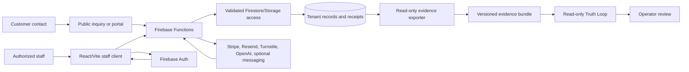
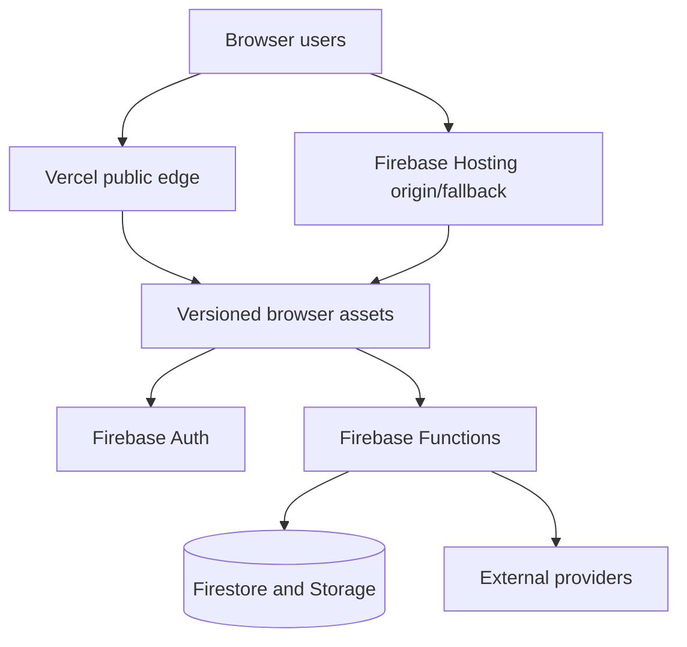

# QuotePilot System Architecture

Last updated: 2026-10-10 21:06:24 CDT

Status: present-tense system architecture. Domain ADRs and executable contracts
remain authoritative for their own invariants.

## System context

QuotePilot is a multi-tenant catering commercial-operations application. A React
and Vite browser client presents public, customer, and role-gated staff surfaces.
Firebase owns identity, tenant data, server-authoritative mutations, and the
origin/fallback deployment. Vercel is the public browser edge. Read-only evidence
and reconciliation tiers inspect exported records without gaining write or
business authority.

## Major modules and responsibilities

| Module | Responsibility | Must not own |
|---|---|---|
| Public and staff web client (`src/`) | Interaction, local draft state, role-safe projection, callable invocation, recovery presentation | Server pricing, privileged authorization, provider truth, settlement, or customer consent |
| Firebase Authentication | User identity, provider session, verification, token claims | Organization membership policy by itself |
| Firestore and Storage | Tenant-scoped durable records, versions, receipts, projections, and bounded assets | Client-derived authority or inferred evidence |
| Firebase Security Rules | Direct-client read/write enforcement at the data seam | Callable business logic or provider reconciliation |
| Firebase Functions (`functions/`) | Tenant/role authorization, exact validation, authoritative pricing, state transitions, provider dispatch, receipts, projections | Human acceptance, physical availability, or provider outcomes not read back |
| Domain libraries and contracts | Pricing, commercial revision, Staffing, Inventory, BEO, workflow, field-state, and evidence invariants | A universal readiness authority |
| Evidence exporter (`evidence/`) | Deterministic projection of already-read authoritative records into reconciliation bundles | Credentials, network access, writes, or policy inference |
| Commercial Truth Loop (`truthloop/`) | Deterministic read-only reconciliation and findings | Pricing, approval, mutation, customer presentation, or provider action |
| Product/release governance | Traceability, validation, evidence classification, and release receipts | Product-owner, provider, production, human, or outcome acceptance |

## Loading and diagnostic boundaries

The October 10 local candidate separates the public entry graph from optional
workspace modules. Staff application loading waits for authentication and tenant
resolution; public portal token precedence and existing missing-configuration
recovery remain intact. The quote composer, wizard steps, and catalog revision
review enter through recoverable lazy boundaries. Existing application checks
still own role eligibility and protected data access; splitting code grants no
new authority. Catalog settings retain their workspace-wide loading gate:
route eligibility and feature controls depend on that shared authority. Each
recoverable lazy instance retains its own failed
import and module selector so retry cannot substitute a sibling module or lose
a named wizard-step export. Dirty quote reload continues to require confirmation.
The compatibility Quote Workspace reuses the existing event summary for event
identity and guest count instead of constructing the full Ambient presentation
model for those fields. This removes an unnecessary presentation dependency
without changing their values, pricing, or authorization.

Ambient and compatibility shells now import the same recoverable route/tool
boundary and sticky-mount helper. Route fallbacks and supplemental section
placeholders reserve bounded responsive geometry, expose status/busy semantics,
and add no focusable controls. Routed Now and Operations own one programmatic
page identity; the Schedule dialog retains its dialog-local heading. These are
presentation/loading contracts and do not move role, tenant, read, or mutation
authority into the boundary.

Production builds use the classic JSX transform with React 18
`createElement`/`Fragment` to reduce emitted helper boilerplate. Development and
test builds retain the automatic JSX transform for diagnostics and Fast Refresh.
This reversible build configuration changes no feature, business authority, or
visual style. Final bundle validation owns the byte evidence; the transform
alone establishes no runtime speed improvement.

Client 360 publishes its exact customer and bounded quote page first. Opening a
proposal history requests only that quote's bounded retained versions; one
scope-owned loader admits at most four reads concurrently, deduplicates active
requests, and gives each failed history its own retry. Scope disposal drops
queued work and ignores late results. Private email controls settle without
waiting for histories. `versionPageInfo.unloadedQuoteIds` distinguishes
unrequested histories from empty completed reads; the relationship timeline
remains partial until its retained histories have been loaded. Earlier read-only
availability does not enable rebook or closeout writes: those controls still
require the exact current completed Firebase read and successful radar evidence.

Now publishes attention, quote history, unread-reply, and pending-decision reads
as they settle. Reporting separates bounded commercial records from product
analytics. Each surface retains loading, unavailable/error, empty, and retained
stale distinctions; unresolved reads cannot produce caught-up or zero-activity
claims. Existing generation and organization fences prevent stale responses
from populating a different scope.

Inventory keeps broad current projections separate from narrow trace and
dependency reads. Opening one ingredient disclosure requests only a bounded,
cursor-ordered set of verified movement summaries plus commitments that
reconcile to exact event plans; raw ledger documents remain server-side. Each
ingredient owns its loading, partial, error, pagination, and retry state, and
generation/entity fences discard late responses. Recipe publication is a
two-step authority: the server returns a bounded role-safe dependency review
for one exact draft, then transactionally recomputes that evidence before
accepting the unchanged command with its issued digest. Browser and direct
population paths cannot create that digest locally. These projections and
reviews do not become stock valuation, physical-count, procurement, pricing,
or whole-event readiness authority.

Multi-line receiving is a client coordinator over the unchanged singular
receive command. It submits lines sequentially, preserves a stable request ID
and receipt outcome per line, locks confirmed work, reconciles uncertain work
through that exact request, and retries only definitive failures. There is no
batch mutation, new write schema, or rule bypass; partial failure therefore
cannot replay an already confirmed stock movement.

Release qualification uses UAT receipt version 5 and production evidence
version 6. The UAT input is a closed, privacy-safe summary bound to one full
release SHA, target, candidate profile, staging deployment, and public provider
origin. It requires distinct hosted administrator, sales, customer, and
cross-tenant observations and rejects emulator, fixture, and auth-bypass modes.
Only the digest and safe summary enter the receipt. This gate validates evidence
shape; it does not run the hosted journeys or establish deployment success.

Session diagnostics recursively apply existing sensitive-key and text rules
before nested serialization. Traversal and array indexes are bounded, cycles and unsafe accessors
are redacted, and serialization failure never falls back to raw object text.
Existing event shape and bounded storage remain local diagnostic evidence.

## Primary data flow

Client observation may describe interaction. It cannot establish pricing,
acceptance, delivery, settlement, or operational authority.

## Core seams

- **Identity seam:** Firebase Auth establishes the user; server and rules still
  validate organization, role, verification, gate, revision, and request context.
- **Commercial seam:** server-owned pricing and version receipts establish the
  saved commercial basis. Client arithmetic is explanatory only.
- **Customer seam:** customer-safe DTOs and current issuance determine what may
  be shown. Internal records are not sent directly to customer surfaces.
- **Provider seam:** dispatch, provider acceptance, delivery, settlement, and
  recipient behavior are separate states reconciled by exact identities.
- **Operational seam:** accepted commercial work is referenced by Staffing,
  Inventory, BEO, workflow, and event-operation modules; no consumer rewrites
  the accepted commercial record.
- **Inventory evidence seam:** tenant/role/revision-fenced functions verify raw
  movement, receipt, allocation, recipe, and dependency records, then return
  bounded summaries or review digests to named surfaces. The client cannot
  upgrade those reads into a count, valuation, reservation, or publication.
- **Evidence seam:** exporter and reconciler consume evidence without credentials,
  network access, writes, or authority to fix findings.

## Trust boundaries

1. Browser input is untrusted, including tenant identifiers, roles, totals,
   lifecycle state, provider outcomes, and imported files.
2. Authentication is necessary but insufficient; authorization is evaluated at
   the owning server or rules seam.
3. Every tenant-scoped operation binds the exact organization and eligible role.
4. Consequential mutations bind revision and request identities and fail closed
   on stale, duplicate, incomplete, or ambiguous state.
5. Customer projections exclude staff-only margin, staffing, provider, evidence,
   and internal commentary unless an explicit contract permits them.
6. Secrets remain in provider/runtime secret stores and never enter repository
   docs, browser payloads, analytics, or reconciliation bundles.
7. Generated suggestions, fixtures, simulations, and findings never become
   business authority by presentation alone.

Rule-level predicate claims are intentionally not duplicated here. The current
graph could not establish tracked freshness for `firestore.rules`; that affected
detail remains `GRAPH_COVERAGE_BLOCKED` until a fresh authorized source review
and the Firestore rules lane confirm it.

## Deployment topology

The public edge, Firebase Hosting, Functions, tenant configuration, provider
configuration, and production data are separately deployed and separately
proved. `README.md` owns runtime versions and entry points; `PROJECT_STATUS.md`
owns current deployment evidence.

## External dependencies

- Firebase Authentication, Firestore, Storage, Functions, and Hosting.
- Vercel public delivery.
- Stripe payment rails; Stripe Connect remains separately stopped.
- Resend transactional delivery.
- Turnstile for governed public inquiry protection.
- OpenAI for bounded model-assisted parsing where enabled.
- Optional messaging/calendar seams only where separately configured and gated.

Provider configuration or a successful health probe never proves a user outcome.

## Failure behavior

- Missing local Firebase configuration keeps the documented local fallback
  rather than fabricating connected authority.
- Authorization, tenant, revision, schema, and exact-money failures fail closed.
- Network/provider ambiguity remains unknown until reconciled; retry is not
  offered when it could duplicate a consequential action.
- Missing, not applicable, not yet available, blocked, contradictory, and schema
  drift remain distinct and produce different operator instructions.
- Stale downstream projections identify their exact basis, owner, and recovery
  action rather than mutating the accepted source.
- Inventory trace and recipe-dependency failures stay local to the selected
  ingredient or draft. Foreign/malformed IDs, cursor drift, stale fences,
  incomplete pages, non-reconciling totals, and changed dependency evidence
  fail closed without clearing unrelated successful workspace state.
- Analytics failure must not block the commercial workflow, but business
  authority remains closed and observable.
- Exporter or reconciler failure cannot mutate production records or establish a
  customer-facing verdict.

## Architecture change rule

A change to module responsibility, trust boundary, storage location, processing
order, public interface, or external dependency requires impact analysis and an
ADR when the decision is expensive to reverse, surprising without context, and
the result of a real trade-off.
